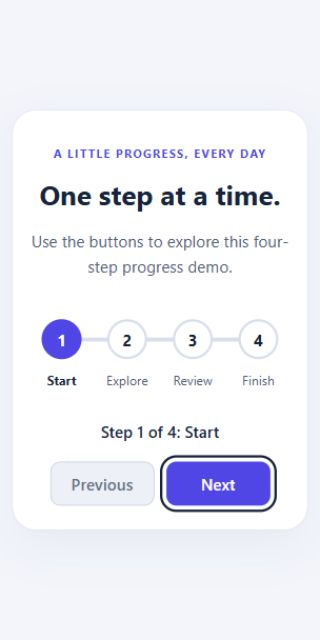

# Progress Steps

A responsive four-step progress demo built with HTML, CSS, and vanilla JavaScript. Move forward or backward to see the current step, completed steps, and connecting progress line update together.

This is a UI interaction demo, not a form or a data-submission flow.

## Preview



## Features

- Four stages: Start, Explore, Review, and Finish.
- Previous and Next controls that stay within the first and last steps.
- Progress line updates to 0%, approximately 33%, approximately 67%, and 100%.
- Numbered steps with the current stage identified by `aria-current="step"`.
- A status region announces step changes to assistive technology.
- Visible keyboard focus and native button activation.
- Focus moves to the enabled opposite control when the focused button becomes disabled at a boundary.
- Responsive layout and support for reduced-motion preferences.
- No dependencies, installation, build step, API keys, or backend.

## Run locally

1. Download the repository using **Code → Download ZIP** and extract it, or clone it:

   ```sh
   git clone https://github.com/Shariatypour/Progress-Steps.git
   cd Progress-Steps
   ```

2. Open `index.html` in a browser. Keep the `css` and `js` folders beside it.
3. Optionally, open the folder in VS Code and use Live Server.

While the improvements are under review, select the `feature/progress-navigation` branch before downloading, or run `git switch feature/progress-navigation` after cloning.

## Controls

| Input | Action |
| --- | --- |
| Click or tap Next | Advance one step |
| Click or tap Previous | Go back one step |
| Tab / Shift + Tab | Move between enabled buttons |
| Enter / Space | Activate the focused button |

Previous is disabled at step 1; Next is disabled at step 4. When the focused control becomes disabled, focus moves to the other button so keyboard navigation can continue.

## How it works

One variable, `currentStep`, stores the selected stage. The `updateProgress()` function synchronizes the step styles, current-step attribute, progress-line width, status text, and disabled buttons.

The progress percentage is:

```js
((currentStep - 1) / (steps.length - 1)) * 100
```

Subtracting 1 makes the first step correspond to 0%. Dividing by the three gaps between four steps gives equal progress increments.

The decorative track is separate from the ordered step list, so changing the line width does not move the circles.

## Project structure

```text
Progress-Steps/
├── index.html       # Ordered steps, status, and navigation buttons
├── css/style.css    # Layout, colors, focus, and motion preferences
├── js/script.js     # State, progress updates, and boundary focus
└── docs/preview.png # Screenshot of the project
```

## Manual checks

- On initial load: step 1, 0% progress, Previous disabled.
- Advance to step 4: 100% progress, Next disabled.
- Return to step 1: 0% progress, Previous disabled.
- Confirm exactly one step has `aria-current="step"` throughout.
- Navigate using Tab, Enter, and Space, including both boundaries.
- Check widths of 320px, 390px, and 1280px for horizontal overflow.
- Enable reduced motion on your device and check that the line changes without a transition.

Browser checks covered the boundary states, Enter/Space activation, focus recovery, and the three viewport widths above. The reduced-motion rule is included; the device preference has not yet been toggled during testing. A screen-reader announcement audit has not yet been performed.

## Project status

Implementation and review are tracked in [pull request #1](https://github.com/Shariatypour/Progress-Steps/pull/1). A public live demo has not been published yet.
